# Health model modelspec: Alpine Huts production

## modelspec CONCEPT

This existing-telemetry model is deployed and evaluating. At the verified 2026-11-06 10:06 UTC observation, all 25 entities and all 28 signals were Healthy, with numeric values, recent evaluation timestamps, and no errors or Unknown states (S27). S24-S27 record the real data repairs, corrected telemetry measurements, and isolation of optional reporting failures; thresholds, entity IDs, relationships, notification routing, and saved layout were preserved. `done` identifies completed scoped work, not an ongoing guarantee of workload health.

## What does health mean for my workload?

- Users can browse huts and read availability from both providers.
- Scheduled hut checks and availability refreshes produce usable stored results.
- Closed huts, full huts, valid empty seasons, and deliberately excluded huts are not failures.
- A successful invocation is not evidence that every hut was refreshed.

## Health modelling strategy

| Model Name | Purpose and platform/workload role | Owner and team/organizational/legal boundary | Tenant, subscription and resource scope | Sources or gap | Status |
|------------|------------------------------------|---------------------------------------------|-----------------------------------------|----------------|--------|
| M_ALPINE_PROD; ARM name `alpinehuts-prod-health` | One production model covering the two maintenance flows and the public viewing flow | Repository/application maintainer; no separate platform ownership boundary established | Tenant `a766971d-c61a-4ccb-b513-d237efc6ac92`; subscription `72096252-3fdc-4ee7-bd90-ea5d0769771f`; group `alpinehutsvnext-rg`, region `westeurope` | S01, S05, S11, S16-S17 | done |

| Approach | Decision and reason | Sources or gap | Status |
|----------|---------------------|----------------|--------|
| One flow-based production model | Accepted and deployed: connects failures to the three requested outcomes and distinguishes working reads from failed updates | S01-S04, S16-S17 | done |
| Resources only | Rejected as the primary design: misses caught application failures and missed or partial refreshes | S03, S07 | done |
| Separate frontend, ingestion, and database models | Not proposed: no separate owners established; adds cross-model configuration without a demonstrated benefit | S01; G_SCOPE | new |

### Resource register

All IDs below are ARM resource IDs, not connection strings. Resource aliases in subsequent tables resolve to these exact IDs.

| Alias | Full resource ID | Role | Status |
|-------|------------------|------|--------|
| R_CRAWLER | `/subscriptions/72096252-3fdc-4ee7-bd90-ea5d0769771f/resourceGroups/alpinehutsvnext-rg/providers/Microsoft.Web/sites/alpinehutscrawler-prod` | Production Flex Consumption crawler, France Central | done |
| R_STORAGE | `/subscriptions/72096252-3fdc-4ee7-bd90-ea5d0769771f/resourceGroups/alpinehutsvnext-rg/providers/Microsoft.Storage/storageAccounts/sthutscrawlerprod` | Timer/host and Azure Storage Durable backend | done |
| R_SQL | `/subscriptions/72096252-3fdc-4ee7-bd90-ea5d0769771f/resourceGroups/alpinehutsV2-rg/providers/Microsoft.Sql/servers/alpinehutsserver/databases/alpinehutsdb` | Production database, West Europe | done |
| R_SWA | `/subscriptions/72096252-3fdc-4ee7-bd90-ea5d0769771f/resourceGroups/alpinehutsvnext-rg/providers/Microsoft.Web/staticSites/alpinehuts` | Production Vue SPA and managed Functions API; Free tier | done |
| R_AI | `/subscriptions/72096252-3fdc-4ee7-bd90-ea5d0769771f/resourceGroups/alpinehutsV2-rg/providers/microsoft.insights/components/alpinehutsfunctions` | Shared Application Insights destination for production, development, browser, and legacy traffic | done |
| R_LOGS | `/subscriptions/72096252-3fdc-4ee7-bd90-ea5d0769771f/resourcegroups/server-loganalytics-rg/providers/microsoft.operationalinsights/workspaces/silenced-eu-loganalytics` | Actual backing workspace; customer ID `1f0bf6ce-1916-4f1f-9a69-f9ec88fdaf98`; observed retention 30 days | done |
| R_NOTIFY | `/subscriptions/72096252-3fdc-4ee7-bd90-ea5d0769771f/resourceGroups/alpinehutsV2-rg/providers/microsoft.insights/actionGroups/Email Me` | Existing enabled notification group; receiver metadata only inspected | done |

## High-level health model diagram

```mermaid
flowchart TB
    E_ROOT["E_ROOT: Alpine Huts"]
    E_H["E_H: Update huts"]
    E_A["E_A: Update availability"]
    E_U["E_U: View hut availability"]
    E_ROOT --> E_H & E_A & E_U
    E_H --> C_H_JOB["C_H_JOB: Run hut checks"]
    E_H --> C_H_SOURCE["C_H_SOURCE: Read hut details"]
    E_H --> C_H_DB["C_H_DB: Store hut details"]
    C_H_JOB --> E_H_FUNC["E_H_FUNC: Functions: alpinehutscrawler-prod (hut checks)"]
    C_H_JOB --> E_H_STORAGE["E_H_STORAGE: Storage: sthutscrawlerprod (hut checks)"]
    C_H_DB --> E_H_SQL["E_H_SQL: SQL: alpinehutsdb (hut details)"]
    E_A --> C_A_JOB["C_A_JOB: Run availability checks"]
    E_A --> C_A_AV["C_A_AV: Read alpine-club availability"]
    E_A --> C_A_HH["C_A_HH: Read holiday-provider availability"]
    E_A --> C_A_DB["C_A_DB: Store availability"]
    E_A --> C_A_REPORT["C_A_REPORT: Build reporting totals; Limited impact"]
    C_A_JOB --> E_A_FUNC["E_A_FUNC: Functions: alpinehutscrawler-prod (availability checks)"]
    C_A_JOB --> E_A_STORAGE["E_A_STORAGE: Storage: sthutscrawlerprod (availability checks)"]
    C_A_DB --> E_A_SQL["E_A_SQL: SQL: alpinehutsdb (availability writes)"]
    E_U --> C_U_WEB["C_U_WEB: Display website"]
    E_U --> C_U_API["C_U_API: Read availability"]
    E_U --> C_U_DB["C_U_DB: Read stored data"]
    E_U --> C_U_FRESH["C_U_FRESH: Recent availability checks"]
    C_U_WEB --> E_U_SWA["E_U_SWA: Static Web App: alpinehuts (website)"]
    C_U_API --> E_U_API_SWA["E_U_API_SWA: Static Web App: alpinehuts (managed API)"]
    C_U_DB --> E_U_SQL["E_U_SQL: SQL: alpinehutsdb (website reads)"]
    C_H_JOB -.-> SIG_H_DUE["SIG_H_DUE: completed daily hut checks"]
    C_A_JOB -.-> SIG_A_AV_DUE["SIG_A_AV_DUE: completed alpine-club checks"]
    C_A_JOB -.-> SIG_A_HH_DUE["SIG_A_HH_DUE: completed holiday-provider checks"]
    C_U_FRESH -.-> SIG_U_STALE["SIG_U_STALE: providers overdue for checks"]
```



Every solid edge is a planned relationship with parent `WorstOf` and child `Standard` impact, except C_A_REPORT, whose impact is `Limited`. Each entity has exactly one parent, except E_ROOT. Dotted signal nodes are not entities. Copies of the same ARM resource are intentional, not shared-parent nodes. No nested models or discovery rules are proposed.

## User concerns and priorities

| Concern or priority | User impact and service expectations | Sources or gap | Status |
|---------------------|--------------------------------------|----------------|--------|
| Hut and availability refreshes | Maintain both the catalogue and booking data | S01 | done |
| Public availability viewing | Cover map/list, hut details, date filtering, and API/database access | S01, S04 | done |
| External booking APIs | Required to refresh data, but not called synchronously when users browse stored results | S02-S04 | done |
| Existing Application Insights data | Reuse current logs before adding instrumentation | S01, S06-S07 | done |
| Useful additional monitoring | Detect partial failures and stale results, not just HTTP failures | S01, S03, S07; G_OUTCOME, G_SYNTHETIC | new |

## User flows

| Flow | User outcome and steps | Health objective | Dependencies and resources | Sources or gap | Status |
|------|------------------------|------------------|----------------------------|----------------|--------|
| F_H / E_H | Keep hut metadata current through daily rotating alpine-club ID checks | Proposed 99% over 30 days; scheduled cycle completes within 30 hours | C_H_JOB, C_H_SOURCE, C_H_DB; R_CRAWLER, R_STORAGE, R_SQL | S01-S03, S05; G_TARGETS | new |
| F_A / E_A | Refresh availability from both booking providers and commit usable results | Proposed 99% over 30 days; each provider has a completed cycle within 26 hours | C_A_JOB, C_A_AV, C_A_HH, C_A_DB; optional C_A_REPORT | S01-S03, S05; G_TARGETS, G_OUTCOME | new |
| F_U / E_U | Browse map/list, choose a hut/date, read availability | Proposed 99.9% over 30 days; successful reads and recent provider checks | C_U_WEB, C_U_API, C_U_DB, C_U_FRESH; R_SWA, R_SQL | S01, S04; G_TARGETS, G_SYNTHETIC | new |

These are health objectives, not measured request-success SLOs or existing promises. Azure health objectives treat Unhealthy as downtime; Degraded does not count as downtime (S10).

## System flows

| Flow | System interactions | Health objective | Dependencies and resources | Sources or gap | Status |
|------|---------------------|------------------|----------------------------|----------------|--------|
| SF_H_RUN | Timer starts UpdateHutsOrchestrator; roughly one seventh of IDs checked per day, in parallel | Daily cycle completes; caught errors remain visible | R_CRAWLER, R_STORAGE | S02-S03, S05 | new |
| SF_H_SOURCE | Read hut information from `www.hut-reservation.org`; conditionally refine location | Provider returns usable hut details; expected nonexistent IDs are not errors | Helpers.cs:15; UpdateHutsFunctions.cs:120-278; G_DEPENDENCIES, G_GEO | new |
| SF_H_SAVE | Save hut details through EF Core | Usable updates committed | R_SQL | S03 | new |
| SF_A_RUN | Two timer/orchestrator paths; sequential activities and durable delays per provider | Each provider completes within its deadline | R_CRAWLER, R_STORAGE | S03, S05 | new |
| SF_A_SOURCE | Alpine-club availability plus hut/category details; holiday-provider initial page/cookies and up to six monthly requests | Classify final provider/parse failures separately from retries and SQL errors | S03; G_DEPENDENCIES | new |
| SF_A_SAVE | Reconcile availability and category lookups; save changes; reporting procedure runs afterward on the alpine-club path | Data writes succeed, including unchanged valid responses | S03; G_OUTCOME | new |
| SF_U_SERVE | SWA serves SPA; browser calls hut, category, hut-detail, and date-filtered availability routes | User can load and read the site, including quiet periods | R_SWA; S04; G_SYNTHETIC, G_SWA_METRICS | new |
| SF_U_READ | Managed API SQL input bindings read R_SQL | Public reads succeed and return meaningful data | S04; G_API_IDENTITY | new |
| SF_U_CURRENT | Compare each provider's completed cycles with expected cadence | Warn for one overdue provider; unhealthy viewing only when both exceed the hard deadline | S05-S07; G_OUTCOME | new |

Production schedules observed in app settings, interpreted as UTC unless a runtime timezone override is discovered during build:

| Setting | Observed value | Meaning | Status |
|---------|----------------|---------|--------|
| HutsUpdateSchedule | `0 0 2 * * *` | Daily 02:00; per-hut alpine-club metadata rotates over seven days | done |
| AvailabilityUpdateSchedule | `0 0 14,23 * * *` | Alpine-club availability at 14:00 and 23:00 | done |
| HuettenHolidayAvailabilityUpdateSchedule | `0 0 13,22 * * *` | Holiday-provider availability at 13:00 and 22:00 | done |
| CleanupSchedule | `0 0 1 * * *` | Daily cleanup, outside the three modelled flows | done |
| TASKHUB_NAME / AzureWebJobsStorage__accountName | `crawler` / `sthutscrawlerprod` | Azure Storage Durable backend; do not model the old Durable Task Scheduler resources as active dependencies | done |

## Alerts

| Alert | Confirmed placement and health objective | Existing rule and suitability | Sources, lookup coverage or gap | Status |
|-------|-----------------------------------------|-------------------------------|---------------------------------|--------|
| A_H | Confirmed E_H, Degraded severity 3 / Unhealthy severity 2 | Degraded alert fired; R_NOTIFY execution confirmed | S08, S16-S18 | done |
| A_A | Confirmed E_A, Degraded severity 3 / Unhealthy severity 2 | Both levels fired during initial evaluation, 0.3593262 seconds apart; both remain Fired in S18 | S07-S08, S16-S18 | done |
| A_U | Confirmed E_U, Degraded severity 3 / Unhealthy severity 2 | Degraded alert fired for the overdue-provider completion proxy; not an HTTP outage | S08, S16-S18; G_SYNTHETIC | done |
| A_ROOT | No root alert configured | No additional root notification; root is Unhealthy in S17 | S10, S16-S18 | done |

R_NOTIFY is configured for all three flow alerts. Do not edit, remove, or disable rules without a separate approved change. A shared database incident can produce three flow notifications. Initial Degraded-to-Unhealthy propagation can also trigger both configured levels for one flow, as observed in S18; there is no cross-flow or cross-severity deduplication.

Alert lookup scope: full metric-alert, scheduled-query-rule, smart-detector-rule, and web-test collections in `alpinehutsV2-rg` and `alpinehutsvnext-rg`, read 2026-11-02 around 15:35-15:39 UTC. No scheduled-query rules were returned in either group; no metric alerts were returned in the latter. This is not a subscription-wide alert inventory.

| Existing full rule ID | Target and condition | Enabled state and suitability | Status |
|-----------------------|----------------------|-------------------------------|--------|
| `/subscriptions/72096252-3fdc-4ee7-bd90-ea5d0769771f/resourceGroups/alpinehutsV2-rg/providers/Microsoft.Insights/metricAlerts/Alpine Huts - Failed requests spike!` | R_AI; `requests/failed` Count > 10 / 5 minutes; excludes 404 | Enabled, severity 3, R_NOTIFY; combines environments and flows | done |
| `/subscriptions/72096252-3fdc-4ee7-bd90-ea5d0769771f/resourceGroups/alpinehutsV2-rg/providers/microsoft.insights/metricAlerts/Failures on Alpine Hut Website or Functions` | R_AI; `requests/failed` Count > 10 / 5 minutes | Disabled, severity 3; no missed-run coverage | done |
| `/subscriptions/72096252-3fdc-4ee7-bd90-ea5d0769771f/resourceGroups/alpinehutsV2-rg/providers/microsoft.insights/metricalerts/homepage ping-alpinehutsfunctions` | Matching web test and R_AI; failed location count 1 / 5 minutes | Rule enabled, severity 1, R_NOTIFY; test disabled | done |
| `/subscriptions/72096252-3fdc-4ee7-bd90-ea5d0769771f/resourcegroups/alpinehutsV2-rg/providers/microsoft.insights/metricalerts/list huts api-alpinehutsfunctions` | Matching web test and R_AI; failed location count 1 / 5 minutes | Rule enabled, severity 1, no notification action; test disabled | done |
| `/subscriptions/72096252-3fdc-4ee7-bd90-ea5d0769771f/resourcegroups/alpinehutsv2-rg/providers/microsoft.alertsmanagement/smartdetectoralertrules/failure anomalies - alpinehutsfunctions` | R_AI; FailureAnomaliesDetector | Enabled; anomaly detection is not scheduled-flow completion evidence | done |
| `/subscriptions/72096252-3fdc-4ee7-bd90-ea5d0769771f/resourcegroups/alpinehutsv2-rg/providers/microsoft.alertsmanagement/smartdetectoralertrules/failure anomalies - app-insights-lnp3lwwdvb5yy` | Legacy `app-insights-lnp3lwwdvb5yy` component | Enabled; not the configured runtime destination | done |
| `/subscriptions/72096252-3fdc-4ee7-bd90-ea5d0769771f/resourcegroups/alpinehutsvnext-rg/providers/microsoft.alertsmanagement/smartdetectoralertrules/failure anomalies - alpinehutscrawler-dev` | Component named `alpinehutscrawler-dev` | Enabled; not the production runtime destination | done |
| `/subscriptions/72096252-3fdc-4ee7-bd90-ea5d0769771f/resourcegroups/alpinehutsvnext-rg/providers/microsoft.alertsmanagement/smartdetectoralertrules/failure anomalies - alpinehutscrawler-prod` | Component named `alpinehutscrawler-prod` | Enabled; current production settings instead point to R_AI | done |

## Shared source material

### S01: User request

- Evidence class: user-stated fact.
- Original location/reference: this conversation; request to build an Azure health model.
- Precise locator and version: names hut updates, availability updates, UI viewing, SQL, Functions, external APIs, Static Web Apps, Application Insights; permits proposals for additional metrics/logs. Exact message timestamp unavailable; supplied conversation clock is 2026-11-02T16:34:31.614+01:00.
- Status: done.

### S02: Repository architecture

- Evidence class: source fact.
- Original location/reference: `FetchDataFunctions/README.md:1-47`; repository revision `cf51359`.
- Precise locator and version: production/development separation, Flex Consumption, Azure Storage Durable backend; deployment settings take precedence over the README's simplified daily cadence.
- Status: done.

### S03: Crawler implementation

- Evidence class: source fact.
- Original location/reference: `FetchDataFunctions/UpdateHutsFunctions.cs:37-278`; `UpdateAvailabilityFunctions.cs:32-221,303-308`; `Functions/HuettenHoliday/HuettenHolidayUpdateAvailabilityFromProvider.cs:53-224`; `Functions/DurableSequentialProcessor.cs:17-36`; `AvailabilityReconciler.cs:36-123`; `Program.cs:23-30,55-74`; revision `cf51359`.
- Precise locator and version: rotating hut IDs; two availability paths; caught failures; reporting after writes; closed-day timestamp semantics; retries; OTel exporter configuration. `HuettenHolidayGetHutsFromProvider.cs:21-41` has HTTP/activity entry points, not a scheduled hut-import trigger.
- Status: done.

### S04: Public site implementation and tests

- Evidence class: source fact.
- Original location/reference: `WebsiteBackendFunctions/WebsiteFunctions/GetAllHutsFunction.cs:22-35`, `GetHutAvailabilityFunction.cs:23-75`, `GetAllAvailabilityOnDateFunction.cs:23-73`; `website/src/main.js:22-34`; `website/src/services/{hut,availability,mapview}-service.js`; `e2e/tests/smoke.spec.js:9-67`; `.github/workflows/e2e-smoke.yml:10-12`; revision `cf51359`.
- Precise locator and version: managed API uses SQL bindings; SPA sends page/fetch data; map backgrounds are image tiles; daily E2E is not a five-minute health signal. Existing availability smoke checks accept 404 and do not establish nonempty/fresh availability.
- Status: done.

### S05: Azure resource/configuration observations

- Evidence class: observed result.
- Original location/reference: read-only Azure CLI ARM inventory, SWA environment list, filtered production crawler/SWA settings, and R_AI/R_LOGS resource reads.
- Precise locator and version: 2026-11-02 approximately 15:34-15:39 UTC; subscription/resource IDs in register; production SWA default branch `main`, host `white-pond-0976e3603.1.azurestaticapps.net`, custom host `alpinehuts.silenced.eu`; dev slot separate. Both runtime destinations resolve to Application Insights app ID `324ebf0d-dcd0-4a07-a12f-fdd10248313c`. Crawler memory 2048 MB. No secret values retained.
- Status: done.

### S06: Telemetry schema and environment isolation

- Evidence class: observed result.
- Original location/reference: `az monitor log-analytics query` against R_LOGS, bounded two-day and seven-day queries.
- Precise locator and version: 2026-11-02 approximately 15:35-15:41 UTC. AppRequests, AppTraces, AppExceptions, AppDependencies, AppPageViews have data. Crawler role is `alpinehutscrawler-prod`; dev is distinct. Browser role is blank. Production browser dependency OperationIds joined to API requests identify `swa-5e094531-9e5e-41d0-8946-c3e0b47bdb2c` (38 matched reads across huts/categories/date availability). Other SWA roles are not assumed production. A separate cache-busted GET /api/huts returned 200, but its probe identifier was not found in the sampled request logs; it does not independently establish a worker binding.
- Status: done.

### S07: Application failure/completion observations

- Evidence class: observed result.
- Original location/reference: R_LOGS AppRequests, AppTraces, AppExceptions; two-day and three-day windows.
- Precise locator and version: 2026-11-02 approximately 15:36-15:40 UTC. Alpine-club availability orchestration started 14:00:17 UTC, duration about 630 seconds, Success=true; reporting timeout exception at 14:10:47 UTC. Hut write truncation error at 02:00:21 UTC coexists with successful activity telemetry. Latest observed holiday-provider completed orchestration started 2026-11-01T13:00:17.8416808Z, duration 72.762514 seconds; zero completions in both the last 17 and 26 hours at observation time. No cause of the missing later cycles established. Crawler dependency records over seven days were InProc/Other, not HTTP or SQL.
- Status: done.

### S08: Alerts and availability tests

- Evidence class: observed result.
- Original location/reference: scoped ARM alert/web-test collections and R_NOTIFY metadata.
- Precise locator and version: 2026-11-02 approximately 15:35-15:39 UTC; rules listed above. Both old web tests have enabled=false; no AppAvailabilityResults in the two-day table inventory. R_NOTIFY enabled with one email receiver; recipient details were not captured.
- Status: done.

### S09: Platform metric and Resource Health observations

- Evidence class: observed result.
- Original location/reference: Azure Monitor metric definitions and one-hour metric reads; Resource Health ARM GETs for R_CRAWLER/R_SWA.
- Precise locator and version: 2026-11-02 approximately 15:36-15:39 UTC. SQL `availability` 100%, `dtu_consumption_percent` 0%, `storage_percent` 9% in final sampled buckets; storage-account `Availability` 100%. SWA SiteErrors, FunctionErrors, SiteHits returned timestamp buckets without values. Flex OnDemandFunctionExecutionCount returned hourly counts, including 0 during an idle hour. Crawler Resource Health returned Unknown for this plan; SWA returned UnsupportedResourceType. Neither is used as a working health signal.
- Status: done.

### S10: Health modelling and signal semantics

- Evidence class: source fact.
- Original location/reference: [Well-Architected health modelling](https://learn.microsoft.com/en-us/azure/well-architected/design-guides/health-modeling), [health-model concepts](https://learn.microsoft.com/en-us/azure/azure-monitor/health-models/concepts), [signals](https://learn.microsoft.com/en-us/azure/azure-monitor/health-models/signals), [creation/permissions](https://learn.microsoft.com/en-us/azure/azure-monitor/health-models/create), [Application Insights data model](https://learn.microsoft.com/en-us/azure/azure-monitor/app/data-model-complete), [supported metrics](https://learn.microsoft.com/en-us/azure/azure-monitor/reference/metrics-index).
- Precise locator and version: retrieved 2026-11-02. Signals consume existing data; a KQL signal returns one numeric record. Limited impact suppresses Degraded and maps Unhealthy to Degraded. Model identity requires resource Reader and workspace Monitoring Reader.
- Status: done.

### S11: Available Azure health-model resource provider

- Evidence class: observed result and source fact.
- Original location/reference: `az provider show --namespace Microsoft.CloudHealth`; subscription health-model resource inventory; [ARM schema](https://learn.microsoft.com/en-us/azure/templates/microsoft.cloudhealth/2026-11-01/healthmodels).
- Precise locator and version: 2026-11-02 approximately 15:39-15:40 UTC. Microsoft.CloudHealth is Registered; `healthmodels` supports West Europe and API `2026-11-01`. An unrelated model `seb-vs-july-15` exists in `healthmodel-rg`, Canada Central; its configuration was not inspected and must not be modified. The older Microsoft.HealthModel provider is not the deployment target.
- Status: done.

### S12: Exact-query and model-structure verification

- Evidence class: observed result.
- Original location/reference: the KQL blocks below, extracted directly from this file and executed as one union query against R_LOGS with the signed-in CLI identity; local diagram/signal-table consistency checks.
- Precise locator and version: 2026-11-02T15:46:08.477552+00:00. All 20 KQL assignments returned exactly one numeric value. Values are recorded in the signal table. The topology check found 25 entities, 24 single-parent relationships, 14 leaves with signals, no cycles, and no virtual-only single-child wrappers. Metric values were checked separately in S09. The future model identity has not been created or tested.
- Status: done.

### S13: Design acceptance and Bicep deployment request

- Evidence class: user confirmation.
- Original location/reference: this conversation; review-form response `existing_telemetry`, then user message: "write the model in bicep and then deploy it".
- Precise locator and version: original message timestamps unavailable; recorded 2026-11-02T15:59:28.089205+00:00. Accepts the existing-telemetry design and Bicep method; new instrumentation stays deferred. Exact Azure resource/role/alert approval and sufficient deployment permissions are still required.
- Status: done.

### S14: Bicep compilation, metric verification, and Azure preflight

- Evidence class: observed result.
- Original location/reference: `infra/healthmodel.bicep`, `infra/healthmodel-sql-access.bicep`, `infra/healthmodel-logs-access.bicep`; core Bicep and Azure CLI.
- Precise locator and version: 2026-11-02 approximately 15:53-15:59 UTC. Bicep compilation and formatting checks pass; local BCP081 warnings indicate unavailable CloudHealth type metadata, so compilation alone is not schema proof. ProviderNoRbac what-if succeeds with 76 Create, 13 Ignore, no modifications/deletions or diagnostics. Five role assignments are resource-scoped; the two cross-group assignments use nested Bicep modules.
- Authorization result: normal Provider preflight fails with `AuthorizationFailed` for `Microsoft.Authorization/roleAssignments/write` on the crawler, storage account, and SWA. No deployment was attempted. Skipping RBAC checks for the read-only diff does not grant deployment rights.
- Metrics: all three unique definitions returned 288 five-minute samples over the preceding day. SQL availability 100%; SQL DTU 0-40.55%; storage availability 100%. Production browser/API correlation again identified the configured worker, with 29 matched requests over one day.
- Status: done; initial blocker resolved in S16, retained here as the original observation.

### S15: Exact generated Bicep queries

- Evidence class: observed result.
- Original location/reference: resolved queryText fields from the successful what-if, executed unchanged against R_LOGS.
- Precise locator and version: 2026-11-02T15:59:28.089205+00:00. All 18 distinct generated KQL definitions, covering 20 assignments, returned one numeric value. Values match S12: hut errors 1, reporting errors 1, holiday-provider completions 0 in both windows, overdue providers 1, alpine-club completions 1/2, and other error counts 0.
- Status: done.

### S16: Successful preflight and exact deployment approval

- Evidence class: observed result and user confirmation.
- Original location/reference: this conversation; "try again now", normal Provider what-if, then approval-form response `deploy: true`.
- Precise locator and version: preflight at 2026-11-02 approximately 16:07 UTC returned the same 76 Create and 13 Ignore resources as the earlier preview, with no modifications or deletions. Production API correlation still identified the same role. Exact approval-response timestamp unavailable; received after preflight and before model creation at 16:08:42 UTC; recorded 2026-11-02T16:13:12Z.
- Approved change: the three Bicep file hashes recorded in the session, subscription/group/region, production API parameter, 25 entities including root, 24 relationships, 28 assignments, 21 definitions, five resource-scoped read roles, and both alert levels for all three flows routed to R_NOTIFY. No application changes or new instrumentation.
- Status: done.

### S17: Deployment and live model evaluation

- Evidence class: observed result.
- Original location/reference: `az deployment group create` using the command below; ARM GETs for the model, complete entity/relationship/definition collections, and all five role assignments.
- Full model resource ID: `/subscriptions/72096252-3fdc-4ee7-bd90-ea5d0769771f/resourceGroups/alpinehutsvnext-rg/providers/Microsoft.CloudHealth/healthmodels/alpinehuts-prod-health`.
- Precise locator and version: deployment `alpinehuts-prod-health` Succeeded at 2026-11-02T16:09:18.997092Z, duration 40.5167657 seconds. Model principal ID `59ce55fb-426e-436f-9383-849aca42f574`; ARM verifies Reader on R_CRAWLER/R_STORAGE/R_SWA/R_SQL and Monitoring Reader on R_LOGS.
- Read-back result: 25 entities, 24 relationships, 21 definitions, no pagination remaining. All declared properties match the approved what-if. All 28 signals evaluated with numeric values, no errors and no Unknown states; reportedAt spans 2026-11-02T16:09:14.3968855Z to 16:09:27.0158108Z. Signal states: 22 Healthy, 4 Degraded, 2 Unhealthy. Entity states: 17 Healthy, 4 Degraded, 4 Unhealthy.
- Flow states: E_H Degraded (hut errors 1); E_A Unhealthy (holiday-provider completions 0 in 26h); E_U Degraded (one provider overdue). Root Unhealthy. Reporting errors 1 make C_A_REPORT Unhealthy with Limited upstream impact.
- Status: done.

### S18: Fired-alert and notification review

- Evidence class: observed result.
- Original location/reference: Alerts Management API `2019-03-01`, last-hour lists filtered to `alpinehutsvnext-rg` and `alpinehutsV2-rg`, plus lifecycle history for all four returned model alerts; model entity status reread.
- Precise locator and version: read 2026-11-02 approximately 16:11-16:14 UTC. Four model alerts, no pagination; zero alerts in the legacy application group in this window. All four are Fired/New and unsuppressed. Each history confirms `ActionsTriggered`: "Action group Email Me executed (Configured on alert rule)".
- Alert scope prefix: `/subscriptions/72096252-3fdc-4ee7-bd90-ea5d0769771f/resourceGroups/alpinehutsvnext-rg/providers/Microsoft.CloudHealth/healthmodels/alpinehuts-prod-health/providers/Microsoft.AlertsManagement/alerts/`.
- Alert IDs: E_U Degraded `0e0e4c86-8341-32f8-ca93-1049bd4a000e` at 16:09:16.5137552Z; E_A Degraded `259348b2-704d-7b2d-ed2b-f1b31a9a000e` at 16:09:17.0033542Z; E_A Unhealthy `01add9ff-9ba2-9bc9-0032-20ee61b4000e` at 16:09:17.3626804Z; E_H Degraded `8b2e3700-07c6-dcab-7fd4-2c02ad0f000e` at 16:09:17.7106044Z.
- Interpretation: three flows triggered four instances because availability passed through Degraded and Unhealthy during initial evaluation. Both configured severity levels notified; this is startup notification overlap, not four separate failures. No alert settings, rules, or acknowledgement states were changed during review. Underlying errors and missing cycles were already observed before deployment in S07.
- Status: done.

### S19: DTU threshold presentation update

- Evidence class: user confirmation and observed result.
- Original location/reference: user request "just put it to >100% maybe?", approval response `apply_dtu_change: true`, `infra/healthmodel.bicep`, and ARM definition/entity reads.
- Precise locator and version: original message/approval timestamps unavailable; recorded 2026-11-02T16:32:49Z. Bicep and the shared `sql-capacity` definition now use Degraded >80%, Unhealthy >100%, rather than Unhealthy <0%. The exact two-property change was previewed and approved.
- Deployment: targeted REST PUT of the existing definition, preserving all other configurable properties and checking for intervening edits. No entities, roles, alerts, or routing were changed. Definition modified at 2026-11-02T16:32:23.711761Z.
- Verification: e-a-sql, e-h-sql, and e-u-sql each evaluated `sql-capacity` as Healthy at 0.3%, with reportedAt 16:32:26.0804655Z, 16:32:26.125514Z, and 16:32:26.2248441Z respectively; no signal errors. Metric, aggregation, five-minute window, refresh interval, and degraded threshold remained unchanged.
- Status: done.

### S20: Reporting failure diagnosis

- Evidence class: observed result and source fact.
- Original location/reference: read-only R_LOGS queries over seven days and the current 17-hour signal window; current c-a-report/e-a-sql entity reads; `FetchDataFunctions/UpdateAvailabilityFunctions.cs:89-105,209-222`.
- Precise locator and version: read 2026-11-02 approximately 16:28-16:30 UTC. Ten matching reporting exceptions in seven days, all execution timeouts; first 2026-10-27T14:09:55.1153726Z, latest 2026-11-02T14:10:47.1502727Z. Ten recorded reporting activities lasted approximately 30 seconds; each request reported Success=true. No matching successful "Inserted ... new rows into reporting table" trace returned in the seven-day query.
- Current evidence: reporting-errors value 1, Unhealthy, reportedAt 2026-11-02T16:24:16.0325864Z; database availability 100%, Healthy, reportedAt 16:24:16.180468Z. The count is historical over 17 hours, not proof of continuous failure at evaluation time.
- Code explanation: the reporting activity invokes `dbo.UpdateAvailabilityReporting` after per-hut availability processing, catches and logs exceptions without rethrowing, and therefore can report a successful invocation despite the SQL command timing out. Limited impact is intentional. The query plan, SQL waits/blocking, and any partial database effects were not inspected, so the underlying reason for the timeout is not established.
- Status: done.

### S21: Persistent designer layout

- Evidence class: user confirmation and observed result.
- Original location/reference: user screenshot/request to include the arranged designer layout in Bicep; complete entity collection from the deployed model; `infra/healthmodel.bicep`.
- Precise locator and version: recorded 2026-11-02T17:03:16Z. All 25 deployed entities had saved canvasPosition values. Bicep now preserves those exact coordinates, including the model-created root under its existing model name; no additional root is created.
- Verification: Bicep compilation and Provider what-if succeed. All 25 resolved positions match the saved Azure layout; all children are below their parents and no positions coincide. No entities are created/deleted by the preview. Only source was updated: the live model already has the requested arranged positions, so no Azure deployment was performed.
- Status: done.

### S22: Reporting root cause and prepared application fix

- Evidence class: observed result reported by the delegated diagnostic agent and reviewed source changes.
- Original location/reference: subagent `reporting-timeout-fix`; read-only SQL procedure/Query Store diagnostics; `FetchDataFunctions/UpdateAvailabilityFunctions.cs`, reporting regression tests, and crawler README.
- Precise locator and version: recorded after the agent's completion on 2026-11-02. Latest retained INSERT ran 30.015 seconds, including 23.645 seconds of log-rate-governor waits, and generated 29.3 MB of log before cancellation. Production S0 caps log throughput at 1 MiB/s. The read-only aggregation took 1.021 seconds and produced 156,890 snapshot rows; DELETE took 0.391 ms. All 57 retained INSERT executions aborted; latest committed snapshot date was 2025-10-30.
- Prepared fix: reporting-context-only 180-second command budget; activity errors remain visible, while the orchestrator treats ordinary reporting failure as optional and propagates cancellation. This preserves the health model's existing completed-bed-refresh meaning and Limited reporting impact. Ten targeted regression cases and the Release build passed after that boundary change; the final Release NUnit run passed all 63 cases. Existing PKCS package-advisory warnings remain.
- Limits: 180 seconds is bounded sixfold headroom, not a measured full-snapshot requirement. Production was unchanged during diagnosis; S23 records the subsequent application deployment. Completion under this budget remains unverified. The procedure has no explicit transaction and the caller starts none, so a failed INSERT does not roll back its preceding DELETE under normal autocommit.
- Status: done; diagnosis and local fix preparation complete, with real-run verification tracked in G_REPORT_TIMEOUT.

### S23: Production crawler patch deployment

- Evidence class: user confirmation and observed result.
- Original location/reference: user request "deploy"; `az functionapp deployment source config-zip`, server-side deployment logs, function index, ARM site metadata, and post-deployment Application Insights startup traces.
- Target: R_CRAWLER, production only. The committed crawler tree matched the last successful production workflow commit `77a9d365ddd47dd77f84cb447019f1fd1dbb7c24`; only the reviewed local reporting patch was new. No commits or pushes were performed.
- Precise locator and version: deployment ID `374b3da6-8c5b-4ffc-8a56-285ec87568b5`, started 2026-11-02T17:19:31.0372485Z, completed 17:19:38.1651663Z. Server status 4 (successful), active=true; CLI returned "Deployment was successful." Verification recorded 2026-11-02T17:25:57Z.
- Artifact: framework-dependent .NET 10 Release ZIP, SHA256 `c530ff3b71dfedbb1b93ea82e3834d06bac1fdcf5629c4dcde20fe19db46953f`; application DLL SHA256 `be00a5a1fb65a8099ae1adce236e2e36563804e7359cc582252466723e216a9c`. Package contained the published app, not local.settings.json, credentials, or test assemblies.
- Verification: app Running on dotnet-isolated 10.0; all 16 published functions indexed, including UpdateAvailabilityReporting. Startup traces confirm "16 functions loaded" and "Worker process started and initialized" at 17:20:45 UTC. Release publish succeeded; the reviewed source had passed all 63 NUnit cases. Existing PKCS advisory warnings remain.
- Scope and limits: no SQL procedure/schema changes, manual reporting invocation, timer changes, health-rule/layout changes, or permission changes. The model's live layout already matches the Bicep coordinates. Actual snapshot completion must be verified on a scheduled run; the next AV crawl starts at 23:00 UTC and invokes reporting after hut processing. The existing 17-hour error lookback can remain red after a successful deployment.
- Status: done; deployment and host readiness verified, not a claim that the SQL snapshot has completed.

### S24: Production data and telemetry repairs

- Evidence class: user confirmation, observed results, and source facts.
- Original location/reference: approved repair bundle in this conversation on 2026-11-05; ARM component/site reads and deployment logs; R_LOGS queries; read-only SQL diagnostics; complete holiday-provider catalog; `FetchDataFunctions/Program.cs`, `Models/AlpinehutsDbContext.cs`, `infra/application-insights-sampling.bicep`, and the two dated `infra/sql/` scripts.
- Diagnosis: successful nightly jobs and fresh database rows existed despite missing job traces. Shared R_AI ingestion sampling was 50%, retained records had ItemCount=2, and the installed exporter also defaulted to a five-traces-per-second limit. A valid 104-character website URL for hut 79 could not fit the nullable nvarchar(100) website column. Holiday-provider records 10141, 10164, and 10167 returned 404 and were absent from the complete ten-page catalog of 50 unique listings.
- Approved changes: retain 100% at ingestion and explicitly disable SDK trace-rate sampling; suppress SQL-command and HTTP-client Information logs, which accounted for over 90% of crawler trace bytes; widen only HutWebsite to nvarchar(2048) in production and development; set only Enabled=false on the three removed production listings, preserving history, manual-edit flags, and other fields; deploy the crawler and run one metadata catch-up partition containing hut 79. No timer, SQL tier, role, alert, or model-identity changes.
- Deployment: production crawler deployment `148b7e02-7314-48cd-a196-604730fdc45f` succeeded and became active; all 16 functions were indexed. R_AI retained keys, routing, tags, and retention; Azure populated its legacy default Flow_Type=Bluefield as disclosed in approval. Both SQL changes preserved Unicode data, nullable status, and collation.
- Catch-up: instance `3aa215dcefe64298bd857ec2b1775916`, created 2026-11-05T20:04:13Z and completed 20:04:22Z. Hut 79 saved the complete URL at 20:04:18.386Z. All 122 activity spans and the orchestration span were retained with ItemCount=1 and zero errors; application traces totalled approximately 0.22 MB without verbose SQL/HTTP Information logs.
- Reporting recovery: scheduled reporting INSERTs completed in approximately 37 seconds and committed a 2026-11-05 snapshot. The subsequent nightly same-day DELETE/INSERT took approximately 94 seconds, within the reporting-only 180-second budget; S25 confirms its Durable completion. Reporting source is committed as `03752817ded9bb5c7ea1ac3d93a0ef459862028f` on dev and included in open dev-to-main PR #511, verified 2026-11-06.
- Limits: the three removals are a guarded one-time correction, not automatic provider lifecycle management. Three newly discovered provider listings were not imported. Complete trace retention does not prove per-hut committed-check coverage or continuous browser reachability.
- Status: done.

### S25: Corrected bed-refresh completion and host-failure measurements

- Evidence class: user confirmation, observed results, and source facts.
- Original location/reference: separate user-approved definition updates on 2026-11-06; R_LOGS live and empty-window query tests; read-only Durable runtime/history; `FetchDataFunctions/Functions/DurableSequentialProcessor.cs:17-36`; `infra/healthmodel.bicep`.
- Diagnosis: AV instance `4e58b66cecb34a83bfa31579f31f8bb5`, created 2026-11-05T23:00Z, completed at 23:10:22Z with reporting TaskCompleted and ExecutionCompleted in Durable history, but its final orchestration span was absent. The existing replay-safe "All 566 UpdateHutAvailability activities finished" trace at 23:08:47.973Z established the bed-refresh boundary before optional reporting. The corresponding holiday-provider completion covered 47 huts at 22:01:31.140Z.
- Changes: six definitions use Q_BED_COMPLETION/Q_STALE on those existing provider completion markers, rather than final orchestration spans. Windows remain 17h/26h, refresh remains 15m, and thresholds are unchanged. Their query time grains now equal the marker lookback because TimeGenerated already represents completion.
- Host correction: the shared crawler-host-failures definition counted a benign GET /favicon.ico 404 as a failed host. Q_HOST now retains genuine non-HTTP invocation failures, HTTP 5xx, and 429, excluding benign HTTP client errors. Its 15-minute window, five-minute refresh, and >=1/ >=5 rules are unchanged.
- Verification: six exact live queries returned numeric counts; six no-completion tests returned provider count 0 or missing-provider count 2, preserving real missed-run detection. Host fixtures retained an activity failure, HTTP 500, and HTTP 429 (count 3), ignored favicon 404/client 400, and returned 0 in a quiet window. Targeted PUT read-back matched all seven approved payloads; no entities, relationships, permissions, layout, alerts, or histories were replaced.
- Status: done.

### S26: Final live evaluation and local validation

- Evidence class: observed result.
- Original location/reference: `az rest` GET of model entities and signaldefinitions using API 2026-11-01 in subscription `72096252-3fdc-4ee7-bd90-ea5d0769771f`, group `alpinehutsvnext-rg`; compiled `infra/healthmodel.bicep`; `dotnet test FetchDataFunctions.Tests/FetchDataFunctions.Tests.csproj -c Release --no-restore`.
- Precise locator and version: entity observation completed 2026-11-06T09:18:48Z. All 25 entities, including root and the three flows, were Healthy. All 28 signals were Healthy with numeric values, reportedAt between 09:12:04Z and 09:18:39Z, and no evaluation errors. Current signal values appear in the Signals table.
- Configuration verification: all seven updated definition payloads matched live read-back, and all 25 canvas positions exactly matched compiled Bicep. No health thresholds were relaxed to obtain the Healthy result.
- Local validation: all 63 Release NUnit cases passed; Bicep compilation passed. Existing PKCS NuGet advisory warnings remain. Local Bicep lacks CloudHealth type metadata (BCP081), so successful Azure validation and live read-back, not compilation alone, establish provider compatibility.
- Limits: this is a dated observation, not proof of continuous end-to-end availability. G_OUTCOME, G_API_IDENTITY, and G_SYNTHETIC remain open.
- Status: done.

### S27: Reporting-only failure isolation

- Evidence class: reviewed source facts and read-only query fixtures.
- Original location/reference: staged-change review; `FetchDataFunctions/UpdateAvailabilityFunctions.cs:101-117,225-241`; R_LOGS reporting invocation identity lookup; `infra/healthmodel.bicep`.
- Diagnosis: ordinary reporting failures are rethrown by their activity, then handled by the orchestrator with an exception-bearing warning. The reporting activity's failed request would also count as a shared crawler-host failure, and the warning would count in the unfiltered AppExceptions application-error branch. That could alert hut maintenance even though reporting has Limited impact.
- Correction: the reporting activity is measured by the dedicated reporting signal, not Q_HOST. Failed orchestrators, including propagated cancellation, and other failed activities remain host-failure evidence. Q_APP_ERRORS excludes both the reporting error and its handled warning. The shared helper changes hut-errors and availability-errors; the host definition is the third affected definition. No threshold, refresh, scope, or routing changes.
- Verification: before correction, reporting-only fixtures returned host=1 and refresh errors=1 instead of 0. After correction, all eight exact-query fixtures passed, covering reporting-only errors, propagated cancellation, genuine activity/orchestration/500/429 faults, harmless 400/404 requests, and quiet windows. The dedicated reporting count remains 1. All three exact queries returned numeric 0 against real telemetry.
- Approval and deployment: the user approved exactly three definition-only PUTs before 2026-11-06T10:06:29Z; completed at 10:06:44Z. Each full read-back matched its approved payload. All 18 generated KQL definitions matched live query logic (ignoring blank lines), with exact other properties. All 25 positions were preserved.
- Live result: after the update, all 25 entities and all 28 signals were Healthy, numeric, timestamped, and error-free. The four affected assignments freshly reported 0 between 10:06:32Z and 10:06:44Z.
- Status: done.

## User input and decisions

| Input or decision and affected items | Attribution and source | Input/decision date/time | Recorded at | Status |
|-------------------------------------|------------------------|--------------------------|-------------|--------|
| Model the three named flows and their dependencies; propose extra monitoring | User, S01 | Exact message timestamp unavailable; conversation date 2026-11-02 | 2026-11-02T15:41:13Z | done |
| Propose a separate production model, tree structure, thresholds, limited-impact reporting, and notification reuse; subsequently accepted in S13 | Agent proposal derived from S01-S11; S13 records acceptance | 2026-11-02T15:41:13Z | 2026-11-02T15:41:13Z | done |
| Accept existing-telemetry design; request Bicep and deployment; defer instrumentation additions | User, S13 | Exact message timestamps unavailable | 2026-11-02T15:59:28.089205+00:00 | done |
| Use standalone Bicep with two small cross-group permission modules; no application or existing alert changes | Agent implementation of S13; S14 | 2026-11-02 approximately 15:53-15:59 UTC | 2026-11-02T15:59:28.089205+00:00 | done |
| Approve the exact Bicep deployment, read-role assignments, and both alert levels routed to R_NOTIFY | User, S16 | Exact response timestamp unavailable; before 2026-11-02T16:08:42Z | 2026-11-02T16:13:12Z | done |
| Set DTU Unhealthy to >100%, retaining Degraded >80%; approve a definition-only update and preserve Bicep source consistency | User, S19 | Exact response timestamp unavailable; before 2026-11-02T16:32:23.711761Z | 2026-11-02T16:32:49Z | done |
| Preserve the arranged designer layout in Bicep, without changing health rules or labels | User, S21 | Exact message timestamp unavailable | 2026-11-02T17:03:16Z | done |
| Deploy the reviewed crawler reporting patch to production | User, S23 | Exact message timestamp unavailable; supplied conversation clock 2026-11-02T18:13:00.613+01:00 | 2026-11-02T17:25:57Z | done |
| Approve production/development website widening, three production listing retirements, complete telemetry, production deployment, and one real metadata catch-up | User, S24 | 2026-11-05; exact response timestamp unavailable | 2026-11-06T09:18:48Z | done |
| Use a normal feature PR into protected dev, feeding existing dev-to-main PR #511; no bypass or automatic main merge | User, S24 | 2026-11-05; exact response timestamp unavailable | 2026-11-06T09:18:48Z | done |
| Approve six completion-definition corrections and the separate crawler-host failure correction without changing thresholds or alert routing | User, S25 | 2026-11-06; exact response timestamps unavailable | 2026-11-06T09:18:48Z | done |
| Approve three query-only reporting-isolation updates, preserving dedicated reporting errors and genuine crawler/cancellation failures | User, S27 | 2026-11-06; before 10:06:29Z | 2026-11-06 10:06 UTC | done |

## Derived entity plan

| Model and entity identity/role | Flows, resources and dependencies | Proposed health meaning and user impact | Supporting sources and short derivation | Evidence gaps or conflicts | Deployment acceptance | Status |
|-------------------------------|-----------------------------------|-----------------------------------------|-----------------------------------------|---------------------------|-------------------|--------|
| M_ALPINE_PROD; E_ROOT; model-created root, layout managed by Bicep | Children E_H, E_A, E_U | Worst health across all three outcomes; not a claim that every user request fails | S01, S10, S17, S21 | G_TARGETS | accepted S16; layout S21 | done |
| E_H; generic flow | Parent E_ROOT; C_H_JOB, C_H_SOURCE, C_H_DB | Hut catalogue maintenance works | S01-S03, S17 | G_OUTCOME | accepted S16 | done |
| C_H_JOB; component | Parent E_H; E_H_FUNC, E_H_STORAGE | Daily scan runs; caught application errors visible | S03, S07, S17 | G_OUTCOME | accepted S16 | done |
| C_H_SOURCE; external-source component/leaf | Parent E_H; alpine-club hut-information endpoint | Observed final fetch/parse failures; not a global provider-status claim | S03, S17 | G_DEPENDENCIES, G_GEO | accepted S16 | done |
| C_H_DB; component | Parent E_H; E_H_SQL | Database supports catalogue writes | S03, S17 | G_OUTCOME | accepted S16 | done |
| E_H_FUNC; Azure resource | Parent C_H_JOB; R_CRAWLER | Host-level invocation failures | S05-S07, S17 | G_HOST_SIGNALS | accepted S16 | done |
| E_H_STORAGE; Azure resource | Parent C_H_JOB; R_STORAGE | Durable/timer storage available | S02, S05, S09, S17 | G_STORAGE | accepted S16 | done |
| E_H_SQL; Azure resource | Parent C_H_DB; R_SQL | Database available with capacity headroom | S05, S09, S17 | G_TARGETS | accepted S16 | done |
| E_A; generic flow | Parent E_ROOT; C_A_JOB, C_A_AV, C_A_HH, C_A_DB, C_A_REPORT | Both provider refresh paths operate | S01-S03, S17 | G_OUTCOME | accepted S16 | done |
| C_A_JOB; component | Parent E_A; E_A_FUNC, E_A_STORAGE | Both provider cycles meet deadlines; application failures visible | S03, S05-S07, S17 | G_OUTCOME | accepted S16 | done |
| C_A_AV; external-source component/leaf | Parent E_A; alpine-club availability/hut-information endpoints | Observe final fetch/parse failures | S03, S17 | G_DEPENDENCIES | accepted S16 | done |
| C_A_HH; external-source component/leaf | Parent E_A; holiday-provider page and monthly endpoint | Observe final cookie/fetch failures | S03, S17 | G_DEPENDENCIES | accepted S16 | done |
| C_A_DB; component | Parent E_A; E_A_SQL | Database supports availability/category writes | S03, S17 | G_OUTCOME | accepted S16 | done |
| C_A_REPORT; optional component/leaf | Parent E_A; Limited impact; reporting procedure on R_SQL | Reporting faults do not imply failure to serve or write live availability | S03-S04, S07, S17 | Accepted limited impact | accepted S16 | done |
| E_A_FUNC; Azure resource | Parent C_A_JOB; R_CRAWLER | Same host resource, separate role in this flow | S05-S07, S17 | G_HOST_SIGNALS | accepted S16 | done |
| E_A_STORAGE; Azure resource | Parent C_A_JOB; R_STORAGE | Same Durable storage, availability flow view | S02, S05, S09, S17 | G_STORAGE | accepted S16 | done |
| E_A_SQL; Azure resource | Parent C_A_DB; R_SQL | Database available for availability writes | S05, S09, S17 | G_TARGETS | accepted S16 | done |
| E_U; generic flow | Parent E_ROOT; C_U_WEB, C_U_API, C_U_DB, C_U_FRESH | People can view reasonably current results | S01, S04, S17 | G_SYNTHETIC, G_OUTCOME | accepted S16 | done |
| C_U_WEB; component | Parent E_U; E_U_SWA | Observe browser execution errors on production pages | S04, S06, S17 | G_SYNTHETIC | accepted S16 | done |
| C_U_API; component | Parent E_U; E_U_API_SWA | Public read routes work | S04, S06, S17 | G_API_IDENTITY | accepted S16 | done |
| C_U_DB; component | Parent E_U; E_U_SQL | Stored results can be read | S04, S17 | G_SYNTHETIC | accepted S16 | done |
| C_U_FRESH; component/leaf | Parent E_U; provider completion evidence only, not a dependency on current crawler uptime | One overdue provider degrades viewing; both beyond 26 hours make it unhealthy | S05-S07, S17 | G_OUTCOME | accepted S16 | done |
| E_U_SWA; Azure resource | Parent C_U_WEB; R_SWA | Observed managed-host failures; does not prove static-content reachability | S05-S06, S09, S17 | G_SWA_METRICS, G_SYNTHETIC | accepted S16 | done |
| E_U_API_SWA; Azure resource | Parent C_U_API; R_SWA | SWA also hosts managed API; no separately owned API Function App was found | S04-S06, S17 | G_API_IDENTITY | accepted S16 | done |
| E_U_SQL; Azure resource | Parent C_U_DB; R_SQL | Same database, public-read role | S04-S05, S09, S17 | G_TARGETS | accepted S16 | done |

## Signals

Baseline assignments below use existing data. Every KQL query runs on R_LOGS and includes the R_AI resource filter. Query definitions and parameter values are part of the measurement contract. All thresholds are proposed defaults (G_TARGETS). Repeated metric/query logic should be saved as reusable signal definitions with per-entity assignments.

S15 rechecked all KQL assignments from the generated Bicep queries; S14 verified metric definitions over one day. S16 approved the deployment, S19 supersedes the DTU threshold, and S25 verifies the corrected completion/host queries including empty-window behavior. The Verification column records the S26 model-identity snapshot; S27 confirms all assignments remain Healthy after reporting isolation. Initial observations remain in S17.

Do not treat missing metric values, inaccessible tables, query errors, or an unverified environment binding as zero. They are verification failures/Unknown, not Healthy. Un-grouped KQL counts intentionally return zero for an accessible but empty window. Such a count means no observed failures, not proof of liveness; cadence counts and the proposed synthetic checks cover that distinction.

| Signal | Entity | Kind and data source | Measurement | Degraded and unhealthy rule | Sources or gap | Verification | Status |
|--------|--------|----------------------|-------------|-----------------------------|----------------|--------------|--------|
| SIG_H_ERRORS | C_H_JOB | KQL; R_LOGS | Q_APP_ERRORS; category `FetchDataFunctions.UpdateHutsFunctions`; 26h window; refresh 15m | Degraded >=1; no Unhealthy threshold | S03, S07, S24; G_OUTCOME | S26: Healthy; value 0 | done |
| SIG_H_DUE | C_H_JOB | KQL; R_LOGS | Q_CYCLE; cycle `orchestration:UpdateHutsOrchestrator`; 26h; refresh 15m | Degraded <1; no Unhealthy threshold | S05-S07, S24 | S26: Healthy; value 2 | done |
| SIG_H_MISSED | C_H_JOB | KQL; R_LOGS | Q_CYCLE; same cycle; 30h; refresh 15m | Unhealthy <1; no Degraded threshold | S05-S07, S24 | S26: Healthy; value 2 | done |
| SIG_H_SOURCE | C_H_SOURCE | KQL; R_LOGS | Q_SOURCE; category `FetchDataFunctions.UpdateHutsFunctions`; 26h; refresh 15m | Degraded >=1; no Unhealthy threshold | S03; G_DEPENDENCIES | S26: Healthy; value 0 | done |
| SIG_H_HOST | E_H_FUNC | KQL; R_LOGS | Q_HOST; 15m; refresh 5m | Degraded >=1; Unhealthy >=5 | S06-S07, S25; G_HOST_SIGNALS | S26: Healthy; value 0 | done |
| SIG_H_STORAGE | E_H_STORAGE | Metric; R_STORAGE | Namespace `Microsoft.Storage/storageAccounts`; `Availability`; Average, PT5M, no dimension filter; refresh 5m | Degraded <99%; Unhealthy <95% | S09; G_STORAGE | S26: Healthy; value 100% | done |
| SIG_H_SQL_AVAIL | E_H_SQL | Metric; R_SQL | Namespace `Microsoft.Sql/servers/databases`; `availability`; Average, PT5M; refresh 5m | Degraded <100%; Unhealthy <99% | S09 | S26: Healthy; value 100% | done |
| SIG_H_SQL_CAPACITY | E_H_SQL | Metric; R_SQL | Same namespace; `dtu_consumption_percent`; Average, PT5M; refresh 5m | Degraded >80%; Unhealthy >100% | S09, S19 | S26: Healthy; value 0% | done |
| SIG_A_ERRORS | C_A_JOB | KQL; R_LOGS | Q_APP_ERRORS; categories `FetchDataFunctions.UpdateAvailabilityFunctions`, `FetchDataFunctions.Functions.HuettenHoliday.HuettenHolidayUpdateAvailabilityFromProvider`; 17h; exclude reporting; refresh 15m | Degraded >=1; no Unhealthy threshold | S03, S07 | S26: Healthy; value 0 | done |
| SIG_A_AV_DUE | C_A_JOB | KQL; R_LOGS | Q_BED_COMPLETION; AV category/activity below; 17h; refresh 15m | Degraded <1; no Unhealthy threshold | S05-S07, S25 | S26: Healthy; value 1 | done |
| SIG_A_AV_MISSED | C_A_JOB | KQL; R_LOGS | Q_BED_COMPLETION; same category/activity; 26h; refresh 15m | Unhealthy <1; no Degraded threshold | S05-S07, S25 | S26: Healthy; value 2 | done |
| SIG_A_HH_DUE | C_A_JOB | KQL; R_LOGS | Q_BED_COMPLETION; holiday-provider category/activity below; 17h; refresh 15m | Degraded <1; no Unhealthy threshold | S05-S07, S25 | S26: Healthy; value 1 | done |
| SIG_A_HH_MISSED | C_A_JOB | KQL; R_LOGS | Q_BED_COMPLETION; same category/activity; 26h; refresh 15m | Unhealthy <1; no Degraded threshold | S05-S07, S25 | S26: Healthy; value 2 | done |
| SIG_A_AV_SOURCE | C_A_AV | KQL; R_LOGS | Q_SOURCE; category `FetchDataFunctions.UpdateAvailabilityFunctions`; 17h; refresh 15m | Degraded >=1; no Unhealthy threshold | S03; G_DEPENDENCIES | S26: Healthy; value 0 | done |
| SIG_A_HH_SOURCE | C_A_HH | KQL; R_LOGS | Q_SOURCE; category `FetchDataFunctions.Functions.HuettenHoliday.HuettenHolidayUpdateAvailabilityFromProvider`; 17h; refresh 15m | Degraded >=1; no Unhealthy threshold | S03; G_DEPENDENCIES | S26: Healthy; value 0 | done |
| SIG_A_HOST | E_A_FUNC | KQL; R_LOGS | Q_HOST; 15m; refresh 5m | Degraded >=1; Unhealthy >=5 | S06-S07, S25; G_HOST_SIGNALS | S26: Healthy; value 0 | done |
| SIG_A_STORAGE | E_A_STORAGE | Metric; R_STORAGE | Same definition as SIG_H_STORAGE | Degraded <99%; Unhealthy <95% | S09; G_STORAGE | S26: Healthy; value 100% | done |
| SIG_A_SQL_AVAIL | E_A_SQL | Metric; R_SQL | Same definition as SIG_H_SQL_AVAIL | Degraded <100%; Unhealthy <99% | S09 | S26: Healthy; value 100% | done |
| SIG_A_SQL_CAPACITY | E_A_SQL | Metric; R_SQL | Same definition as SIG_H_SQL_CAPACITY | Degraded >80%; Unhealthy >100% | S09, S19 | S26: Healthy; value 0% | done |
| SIG_A_REPORT | C_A_REPORT | KQL; R_LOGS | Q_REPORT; 17h; refresh 15m | Unhealthy >=1; no Degraded threshold; Limited impact maps failure to Degraded upstream | S03, S07, S24-S25 | S26: Healthy; value 0 | done |
| SIG_U_BROWSER | C_U_WEB | KQL; R_LOGS | Q_BROWSER; 15m; refresh 5m | Degraded >=1; Unhealthy >=5 | S04, S06; G_SYNTHETIC | S26: Healthy; value 0 | done |
| SIG_U_HOST | E_U_SWA | KQL; R_LOGS | Q_SWA_HOST; current verified production role; 15m; refresh 5m | Degraded >=1; Unhealthy >=5 | S06; G_API_IDENTITY, G_SWA_METRICS | S26: Healthy; value 0 | done |
| SIG_U_API | C_U_API | KQL; R_LOGS | Q_READS; production public read routes; 15m; refresh 5m | Degraded >=1; Unhealthy >=5 | S04, S06; G_API_IDENTITY | S26: Healthy; value 0 | done |
| SIG_U_API_HOST | E_U_API_SWA | KQL; R_LOGS | Q_SWA_HOST; same definition as SIG_U_HOST | Degraded >=1; Unhealthy >=5 | S06; G_API_IDENTITY | S26: Healthy; value 0 | done |
| SIG_U_SQL_AVAIL | E_U_SQL | Metric; R_SQL | Same definition as SIG_H_SQL_AVAIL | Degraded <100%; Unhealthy <99% | S09 | S26: Healthy; value 100% | done |
| SIG_U_SQL_CAPACITY | E_U_SQL | Metric; R_SQL | Same definition as SIG_H_SQL_CAPACITY | Degraded >80%; Unhealthy >100% | S09, S19 | S26: Healthy; value 0% | done |
| SIG_U_LATE | C_U_FRESH | KQL; R_LOGS | Q_STALE; 17h; refresh 15m | Degraded >=1; no Unhealthy threshold | S05-S07, S25; G_OUTCOME | S26: Healthy; value 0 | done |
| SIG_U_STALE | C_U_FRESH | KQL; R_LOGS | Q_STALE; 26h; refresh 15m | Degraded >=1; Unhealthy >=2 | S05-S07, S25; G_OUTCOME | S26: Healthy; value 0 | done |

### Executable KQL definitions

For each assignment concatenate this prelude, its parameter declarations from the signal table, then the named query body. `lookback` is a KQL timespan, `cycle`, `category`, and `activity` are string literals, and `categories` is a dynamic string array. The examples below specify all required parameters. The query time range must include `lookback`; only Q_CYCLE needs `lookback + 1d` to include an orchestration's start. Q_BED_COMPLETION/Q_STALE use completion-event timestamps directly.

#### KQL_PRELUDE

```kusto
let ai = "/subscriptions/72096252-3fdc-4ee7-bd90-ea5d0769771f/resourceGroups/alpinehutsV2-rg/providers/microsoft.insights/components/alpinehutsfunctions";
let crawler = "alpinehutscrawler-prod";
let productionApi = "swa-5e094531-9e5e-41d0-8946-c3e0b47bdb2c";
let productionHosts = dynamic(["alpinehuts.silenced.eu", "white-pond-0976e3603.1.azurestaticapps.net"]);
```

#### Q_APP_ERRORS

Parameters: `let lookback = 26h; let categories = dynamic(["FetchDataFunctions.UpdateHutsFunctions"]);` for SIG_H_ERRORS; `let lookback = 17h; let categories = dynamic(["FetchDataFunctions.UpdateAvailabilityFunctions", "FetchDataFunctions.Functions.HuettenHoliday.HuettenHolidayUpdateAvailabilityFromProvider"]);` for SIG_A_ERRORS.

```kusto
union
    (AppTraces
    | where TimeGenerated > ago(lookback) and _ResourceId =~ ai and AppRoleName == crawler
    | where SeverityLevel >= 3
    | project Properties),
    (AppExceptions
    | where TimeGenerated > ago(lookback) and _ResourceId =~ ai and AppRoleName == crawler
    | project Properties)
| where tostring(Properties.CategoryName) in (categories)
| where tostring(Properties.OriginalFormat) !in (
    "Exception in executing stored procedure to update availability reporting",
    "Availability reporting failed after hut updates completed")
| summarize value = count()
```

This measures application error records, not failed-hut counts. EF framework duplicates are excluded by category. Exception logs may be exported to AppExceptions rather than AppTraces, so both tables are required. Reporting errors and their handled warning are isolated to the dedicated reporting signal (S27).

#### Q_CYCLE

Parameters: `let lookback = 26h; let cycle = "orchestration:UpdateHutsOrchestrator";` with the exact cycle/window substitutions in the signal table.

```kusto
AppRequests
| where TimeGenerated > ago(lookback + 1d) and _ResourceId =~ ai and AppRoleName == crawler
| where Name == cycle and Success == true
| extend CompletedAt = TimeGenerated + DurationMs * 1ms
| where CompletedAt > ago(lookback) and CompletedAt <= now()
| summarize value = count()
```

This is orchestration completion, not end-to-end business success. A zero is a missed-completion measurement, not an invented state code.

#### Q_BED_COMPLETION

Parameters: `let lookback = 17h;` or `26h`, with `let category = "FetchDataFunctions.UpdateAvailabilityFunctions"; let activity = "UpdateHutAvailability";` for AV, or `let category = "FetchDataFunctions.Functions.HuettenHoliday.HuettenHolidayUpdateAvailabilityFromProvider"; let activity = "HuettenHolidayUpdateAvailabilityActivityTrigger";` for the holiday provider.

```kusto
AppTraces
| where TimeGenerated > ago(lookback) and _ResourceId =~ ai and AppRoleName == crawler
| where tostring(Properties.CategoryName) == category
    and tostring(Properties.ActivityName) == activity
| where Message startswith "All " and Message endswith " activities finished"
| summarize value = count()
```

This existing replay-safe marker records provider processing completion before optional reporting. It remains a completion proxy, not proof that every individual hut committed usable data. Complete telemetry retention is required (S24); S25 explains why final long-lived orchestration spans are not used for bed-refresh deadlines.

#### Q_SOURCE

Parameters: `let lookback = 26h; let category = "FetchDataFunctions.UpdateHutsFunctions";` or the two 17h availability/category substitutions in the signal table.

```kusto
AppTraces
| where TimeGenerated > ago(lookback) and _ResourceId =~ ai and AppRoleName == crawler
| where SeverityLevel >= 3 and tostring(Properties.CategoryName) == category
| where Message startswith "Error fetching hut info"
    or Message startswith "Error deserializing hut info"
    or Message startswith "Could not get availability"
    or Message startswith "Could not parse availability"
    or Message startswith "Could not get hut info"
    or Message startswith "Could not parse hut info"
    or Message startswith "Failed to fetch initial cookies"
    or Message startswith "Failed to extract cookies"
    or Message startswith "Failed to fetch availability from HuettenHoliday"
| summarize value = count()
```

Only explicit provider-response/parse logs are attributed to sources. Generic caught exceptions can actually be SQL failures, despite their message mentioning the provider, so Q_APP_ERRORS handles them instead. Expected nonexistent alpine-club hut IDs and normal empty holiday-provider months are not counted.

#### Q_HOST

No parameters.

```kusto
AppRequests
| where TimeGenerated > ago(15m) and _ResourceId =~ ai and AppRoleName == crawler
| where not(Name contains "/admin/")
| where Name != "activity:UpdateAvailabilityReporting"
| where Success == false
| where (isempty(Url) and (isempty(ResultCode) or ResultCode == "0"))
    or toint(ResultCode) >= 500 or ResultCode == "429"
| summarize value = count()
```

Non-HTTP failed invocations and HTTP 5xx/429 remain faults. Reporting activities are measured by their dedicated signal; failed orchestrators, including cancellation, remain counted (S27). Benign HTTP client errors, such as favicon 404, do not mean the crawler host failed (S25).

#### Q_REPORT

No parameters.

```kusto
AppExceptions
| where TimeGenerated > ago(17h) and _ResourceId =~ ai and AppRoleName == crawler
| where tostring(Properties.CategoryName) == "FetchDataFunctions.UpdateAvailabilityFunctions"
| where tostring(Properties.OriginalFormat) == "Exception in executing stored procedure to update availability reporting"
| summarize value = count()
```

#### Q_BROWSER

No parameters.

```kusto
let productionOperations = AppPageViews
    | where TimeGenerated > ago(1h) and _ResourceId =~ ai
    | where tostring(parse_url(Url).Host) in~ (productionHosts)
    | where isnotempty(OperationId)
    | distinct OperationId;
AppExceptions
| where TimeGenerated > ago(15m) and _ResourceId =~ ai
| where ClientType == "Browser" and OperationId in (productionOperations)
| summarize value = count()
```

Production browser errors are correlated to a production page, not selected by the blank browser role. Errors on pages left open beyond one hour can be missed; long-lived page context and Vue error handling are part of G_SYNTHETIC. Zero traffic is not a failed page load.

#### Q_SWA_HOST

No parameters.

```kusto
AppRequests
| where TimeGenerated > ago(15m) and _ResourceId =~ ai and AppRoleName == productionApi
| where toint(ResultCode) >= 500
| summarize value = count()
```

#### Q_READS

No parameters.

```kusto
AppRequests
| where TimeGenerated > ago(15m) and _ResourceId =~ ai and AppRoleName == productionApi
| where Name startswith "GET api/"
| where Name startswith "GET api/huts"
    or Name startswith "GET api/availability/"
    or Name == "GET api/bedcategories"
| where Success == false and ResultCode != "404"
| summarize value = count()
```

404 is allowed by current frontend behavior and is not treated as a failed read. A new synthetic check must distinguish a legitimate empty result from a missing expected fixture.

#### Q_STALE

Parameters: `let lookback = 17h;` or `let lookback = 26h;`.

```kusto
let completedProviders = toscalar(AppTraces
    | where TimeGenerated > ago(lookback) and _ResourceId =~ ai and AppRoleName == crawler
    | extend Activity = tostring(Properties.ActivityName), Category = tostring(Properties.CategoryName)
    | where (Activity == "UpdateHutAvailability" and Category == "FetchDataFunctions.UpdateAvailabilityFunctions")
        or (Activity == "HuettenHolidayUpdateAvailabilityActivityTrigger"
            and Category == "FetchDataFunctions.Functions.HuettenHoliday.HuettenHolidayUpdateAvailabilityFromProvider")
    | where Message startswith "All " and Message endswith " activities finished"
    | summarize count_distinct(Activity));
print value = 2 - completedProviders
```

### Proposed monitoring additions

These are requested-for-review code/monitoring changes, not baseline signal assignments. Do not add a signal depending on them before real data is observed.

| Addition | Exact behavior and placement | Proposed health rule | Sources or gap | Status |
|----------|------------------------------|----------------------|----------------|--------|
| I_OUTCOME | At each provider/hut activity, record attempted/validated/committed/failed/skipped outcomes after the final retry and database commit; aggregate one replay-safe run summary with flow, provider, run ID, start/end, expected/attempted/succeeded/failed/skipped counts, coverage, duration, and committed-check time | Degraded if any expected hut fails; Unhealthy if expected count >0 and none succeed, or no valid completed run by deadline; a valid zero-eligible run is not a failure. Tune percentage-based partial-failure thresholds after observing coverage | S03, S07; G_OUTCOME | new |
| I_FRESHNESS | Record latest successful validated fetch/commit check per enabled hut, independently of whether rows changed; periodically emit per-provider eligible/fresh/stale/missing counts; retain expected closed/seasonal/disabled semantics | Suggested fresh horizon 26h for availability; metadata horizon 8 days for rotating alpine-club huts. Do not use global MAX(LastUpdated), row count, or oldest closed row as success | S03; G_OUTCOME | new |
| I_DEPENDENCIES | Add/enable compatible OTel HTTP-client and SQL-client instrumentation in both Functions apps; verify exported AppDependencies against real provider and SQL calls; classify retry attempts separately from final failures | Use final-operation failure counts first; keep 403/429 counts and retry/duration metrics diagnostic until justified | S03, S07; G_DEPENDENCIES | new |
| I_ENVIRONMENT | Give browser/backend data stable application and production/development labels; maintain production API-role verification until a stable filter is proven after redeploy | Never mix dev, legacy app, or old SWA workers into production signals; missing binding is Unknown | S05-S06; G_API_IDENTITY | new |
| I_BROWSER_CHECK | Run an external read-only browser check every 5 minutes: load map/list, verify markers and default map images, open an enabled hut with expected availability, verify displayed response and content; report result/duration into Application Insights. Add an independent HTTP check for site/API reachability | Suggested Degraded on one failed run; Unhealthy after 3 consecutive failures; missing check result for 15 minutes is a monitoring failure, not success | S04, S08; G_SYNTHETIC | new |
| I_BROWSER_ERRORS | Forward Vue render/async handling errors through the existing browser SDK with route and environment, without user content; capture failed tile loads; measure time until usable availability is displayed | Start with error counts; proposed view-time warning >3s, unacceptable >10s only after sample adequacy is established | S04; G_SYNTHETIC, G_GEO | new |
| I_CAPACITY | Retain SQL DTU/storage/workers pressure, connection errors/deadlocks, storage service errors, and crawler duration/volume for diagnosis | SQL storage warning >90%, critical risk >98% (assumed); no claim these diagnostic metrics prove user failure. Add to rollup only after continuity/meaning is verified | S09; G_TARGETS, G_STORAGE | new |

Keep metric dimensions low-cardinality: flow, provider, environment, outcome. Hut IDs/run IDs belong in correlated logs, not per-hut metric series. Do not collect cookies, provider tokens, connection strings, user email, request/response bodies, or SQL parameter values. Use the existing retry configuration; the model must not introduce frequent direct polling of the providers.

## Gaps and open decisions

| Gap or conflict | Category | Affected items | Known evidence and alternatives | Required resolution and owner | Status |
|-----------------|----------|----------------|--------------------------------|-------------------------------|--------|
| G_SCOPE; production-first, separate model, optional reporting | assumption | M_ALPINE_PROD, C_A_REPORT | S16 accepts scope; S17 confirms separate production model and Limited reporting impact | Resolved for the initial deployment; unrelated existing model unchanged | done |
| G_TARGETS; targets, windows, thresholds, alert severities | assumption | All signals and flow objectives | Longest planned provider interval is 15h; 17h warning permits 2h grace, 26h hard deadline permits 11h. Huts use 26h/30h daily-cycle deadlines. Per-hut hut metadata needs a weekly, not daily, freshness expectation | User can change defaults; build verifies real cadence/runtime timezone before deployment | new |
| G_DEPLOY; exact approved deployment and identity permissions | user input | M_ALPINE_PROD | S16 normal preflight succeeds and user approves; S17 confirms deployment, all five ARM role assignments, and actual signal evaluations | Resolved; all access verification used ARM, not Entra directory APIs | done |
| G_NOTIFY; flow alerts and notification reuse | user input | A_H, A_A, A_U | S16 explicitly approves R_NOTIFY routing; S18 confirms four initial alert instances and four action-group executions | Initial routing verified. Both availability severity levels notified during startup; any noise-reduction change requires user approval | done |
| G_OUTCOME; completed cycles can contain failed/partial writes | user input | F_H, F_A, C_U_FRESH; I_OUTCOME, I_FRESHNESS | S07 proves Success=true does not mean business success. Closed AV sentinel rows are not timestamp-refreshed when already closed; valid unchanged/empty seasons must not fail freshness | Approve activity/run outcome and freshness instrumentation. Baseline combines completion counts with caught-error queries, but must be labelled a completion proxy until committed-check coverage is observed | new |
| G_DEPENDENCIES; no HTTP/SQL dependency spans observed | user input | External-source components; I_DEPENDENCIES | Seven-day crawler dependency types were only InProc/Other. Current fetch/parse logs can support baseline counts but cannot separate every transport, retry, and SQL failure | Approve explicit instrumentation; verify successful and failed external/SQL spans before adding dependency-based signals | new |
| G_API_IDENTITY; generated SWA worker roles can change | research/lookup | C_U_API, E_U_SWA, E_U_API_SWA; I_ENVIRONMENT | S06 production browser OperationIds establish current worker, not a durable service identity | Revalidate binding during build and after redeploy. Stable environment/service tags need a separately approved code change; never keep a zero-failure signal Healthy after its binding disappears | new |
| G_SWA_METRICS; published metrics had no values | research/lookup | E_U_SWA, E_U_API_SWA | S09: SiteErrors/FunctionErrors/SiteHits empty in sampled hour; Resource Health unsupported. Definitions alone do not prove availability of a signal | Use scoped request-log fallback for observed managed-host faults; build may add platform metrics only after actual values are verified. Fallback does not prove static-content reachability | new |
| G_HOST_SIGNALS; Flex Resource Health unavailable | research/lookup | E_H_FUNC, E_A_FUNC | S09: Resource Health Unknown; execution count is workload/cost data, not a fault signal | Use existing failed-invocation log counts, paired with cycle deadlines; avoid CPU/memory health thresholds without verified idle behavior and instance semantics | new |
| G_STORAGE; account availability does not prove Durable access | research/lookup | E_H_STORAGE, E_A_STORAGE | Account availability observed; permission/user errors, individual queue/table faults, and orchestration backlog can be hidden by account averages | During build inspect blob/queue/table availability/error evidence and host storage errors; do not add leaf entities with no signal. Cadence checks remain the end-to-end protection | new |
| G_SYNTHETIC; no continuous end-to-end evidence | user input | F_U, C_U_WEB, C_U_API, C_U_DB; I_BROWSER_CHECK, I_BROWSER_ERRORS | Old tests disabled; daily GH suite too sparse and permits availability 404. Count=0 during no traffic is not reachability proof | Approve five-minute checks and Application Insights result reporting; validate nonempty meaningful fixture/closed-season rules and outage/missing-result behavior | new |
| G_GEO; default map tiles and location lookup coverage | user input | F_H, F_U | Default OpenStreetMap image tiles are in the public map path; OSM/Azure Maps enrich selected huts. No verified current tile/lookup failure signal established | Cover default tiles in the browser check; propose limited-impact map-background/location-lookup entities only after actual signals exist. Optional alternative map styles remain outside scope | new |
| G_CURRENT_HH; recent expected holiday-provider cycles absent | research/lookup | C_A_JOB, C_U_FRESH | S24 establishes sampled/missing telemetry and removes three verified retired listings; S25-S26 establish completed provider checks in both deadline windows | Resolved by data/telemetry repairs and corrected completion measurements, not relaxed thresholds | done |
| G_REPORT_TIMEOUT; reporting procedure does not complete within the command timeout | research/lookup | C_A_REPORT | S22-S23 identify throttling and deploy the reporting-only budget; S24-S25 verify real scheduled INSERTs, a current committed snapshot, and nightly Durable reporting completion | Recovery verified on real scheduled production runs; retain bounded timeout and optional failure propagation | done |

## Intent acceptance

| Concrete intent and affected models/entities | State | Attributable user acceptance/reference | Status |
|---------------------------------------------|-------|----------------------------------------|--------|
| Three requested flows and SQL/Functions/SWA/provider dependencies | Accepted and deployed | S01, S13, S16-S17 | done |
| Production model, West Europe, tree, per-flow resource copies, WorstOf, limited-impact reporting | Accepted and deployed | S13, S16-S17 | done |
| Numeric thresholds, health objectives, alert placement and notification reuse | Accepted and deployed | S13, S16-S18; defaults remain adjustable, not external service promises | done |
| Outcome/freshness, dependency, browser-check and environment-label instrumentation | Deferred from the first deployment | S13 selects existing telemetry only | done |

### Planning/build acceptance checks

| Check | Evidence or required result | Status |
|-------|-----------------------------|--------|
| Flow and tree coverage | 3 flows; 25 entities including root; 24 parent relationships; all 14 leaves have baseline signal assignments; no virtual entity has only one virtual child | done |
| Platform metric evidence | S14: 288 samples per unique metric over one day; unavailable Flex/SWA Resource Health signals explicitly disabled in Bicep | done |
| Exact KQL value/shape verification | S12: all 20 documented KQL assignments executed successfully as the CLI user and returned one numeric value; shared definitions cover all assignments | done |
| Build-time permissions and alert checks | S17: model identity reads every signal with no errors; source binding revalidated. S18: all four initial alert instances executed R_NOTIFY | done |
| Full UI proof | Requires approved synthetic/browser instrumentation; baseline is an observed-fault/completion model, not verified end-to-end availability | problem: G_SYNTHETIC not implemented |
| Persistent implementation | Standalone model and permission Bicep, sampling Bicep, guarded SQL scripts, modelspec/plan, and reviewed crawler fixes. Normal feature PR into dev is the approved source-control path; #511 promotes dev to main | done |
| Generated query verification | S15: all 18 distinct generated KQL definitions, covering 20 assignments, return one numeric value | done |
| Azure deployment diff | S14: 76 additive resources, no modifications/deletions; permission checks deliberately remain separate from the successful read-only diff | done |
| Deployment and live evaluation | S17: model Succeeded, exact configuration matched, 28/28 signals evaluated with timestamps/numeric values and no errors or Unknown states | done |
| Designer layout persistence | S21: all 25 Bicep positions exactly match the user's saved Arrange layout, including the model-created root; compile and Azure preview pass | done |
| Reporting patch deployment | S23: approved crawler package is the active successful deployment; all 16 functions indexed and worker startup confirmed | done |
| Reporting performance recovery | S24-S25: scheduled INSERTs committed a current snapshot; nightly reporting completed within its 180-second budget | done |
| Data and trace-retention repairs | S24: website widening in both databases, three production listing retirements, complete ingestion/SDK trace retention, successful real catch-up | done |
| Completion and host measurements | S25-S26: all seven corrected definitions match approved read-back; real/empty tests passed; all 28 signals and all 25 entities freshly Healthy | done |
| Optional reporting isolation | S27: eight regression fixtures and three real queries passed; approved query-only updates freshly evaluate Healthy without leaking handled reporting failures into hut maintenance | done |

### Deployment artifact and command

`infra/healthmodel.bicep` is the entry point. Its two local modules assign Reader on R_SQL and Monitoring Reader on R_LOGS at their own resource-group scopes. The entry point assigns Reader on R_CRAWLER, R_STORAGE, and R_SWA.

The initial model deployment completed successfully in S17; S25 records the subsequent approved definition-only corrections. Reproducible model command:

```bash
az deployment group create \
  --subscription 72096252-3fdc-4ee7-bd90-ea5d0769771f \
  --resource-group alpinehutsvnext-rg \
  --name alpinehuts-prod-health \
  --template-file infra/healthmodel.bicep \
  --parameters productionApiRole=swa-5e094531-9e5e-41d0-8946-c3e0b47bdb2c
```

Revalidate the production worker parameter before a future redeployment if the website has changed since S16. Bicep manages all 25 entities, including the model-created root under its existing name, plus 24 relationships, 28 signal assignments, 21 definitions, one authentication setting, and five role assignments. The root declaration sets its saved position; it does not create another root or replace its history. All entity positions preserve the arranged designer layout (S21, S26). Three flow entities each configure Degraded/Unhealthy notifications to R_NOTIFY. S18 confirms four initial alerts and action-group executions. The model deployment does not modify application resources or data; S24's separately approved repairs changed crawler telemetry, R_AI sampling, the website column, and three production Enabled flags.

The model shares the workload subscription and the SQL/SWA region. That is the accepted initial scope, but it does not provide an independently located view during a West Europe outage. Health-model/query/alert charges may apply; no application hosting tier is upgraded.

The API requires an unhealthy comparison. Warning-only nonnegative counts retain `LessThan 0` as an unreachable unhealthy condition. At the user's request, DTU consumption instead uses `GreaterThan 100` (S19), with Degraded still `GreaterThan 80`; valid readings up to 100% do not make that signal Unhealthy. Automatic Resource Health is disabled on all resource entities so unsupported implicit signals do not appear in addition to the 28 verified assignments.
