# Health Model for Alpine Huts

## What does health mean for my workload?

People can find huts and see current availability. Hut details are checked on schedule, and availability is refreshed from both booking providers. A closed or fully booked hut is a valid result, not a fault.

## User flows

| User flow | What users do | Depends on | Signals | Health target | Alert |
|-----------|---------------|------------|---------|---------------|-------|
| Update huts | Keep hut details current | Run hut checks, Read hut details, Store hut details | Missed daily checks, provider errors, write errors, database and job-storage availability | 99% (assumed) | Degraded or unhealthy |
| Update availability | Keep both providers' availability current | Run availability checks, Read alpine-club availability, Read holiday-provider availability, Store availability, optional Build reporting totals | Missed refreshes, provider errors, write errors, database and job-storage availability, reporting errors | 99% (assumed) | Degraded or unhealthy |
| View hut availability | Browse the map or list, open a hut, and see availability | Display website, Read availability, Read stored data, Recent availability checks | Browser errors, failed API reads, database availability, overdue provider refreshes | 99.9% (assumed) | Degraded or unhealthy |

**Not modelled:** administration, notification subscriptions, manual holiday-provider hut imports, and optional map styles. Map backgrounds and location lookups are recorded as monitoring additions in the [technical specification](modelspec.md).

## Diagram

```mermaid
flowchart TB
    ROOT["Alpine Huts"]:::model
    H["Update huts"]:::journey
    A["Update availability"]:::journey
    U["View hut availability"]:::journey
    ROOT --> H & A & U

    H --> HJ["Run hut checks"]:::system
    H --> HS["Read hut details"]:::system
    H --> HD["Store hut details"]:::system
    HJ --> HF["Functions: alpinehutscrawler-prod<br/>(hut checks)"]:::resource
    HJ --> HT["Storage: sthutscrawlerprod<br/>(hut checks)"]:::resource
    HD --> HQ["SQL: alpinehutsdb<br/>(hut details)"]:::resource

    A --> AJ["Run availability checks"]:::system
    A --> AV["Read alpine-club availability"]:::system
    A --> HH["Read holiday-provider availability"]:::system
    A --> AD["Store availability"]:::system
    A --> AR["Build reporting totals<br/>Limited impact"]:::optional
    AJ --> AF["Functions: alpinehutscrawler-prod<br/>(availability checks)"]:::resource
    AJ --> AT["Storage: sthutscrawlerprod<br/>(availability checks)"]:::resource
    AD --> AQ["SQL: alpinehutsdb<br/>(availability writes)"]:::resource

    U --> UW["Display website"]:::system
    U --> UA["Read availability"]:::system
    U --> UD["Read stored data"]:::system
    U --> UF["Recent availability checks"]:::system
    UW --> US["Static Web App: alpinehuts<br/>(website)"]:::resource
    UA --> UX["Static Web App: alpinehuts<br/>(managed API)"]:::resource
    UD --> UQ["SQL: alpinehutsdb<br/>(website reads)"]:::resource

    ERR["Errors reported by the app<br/>Degraded after an error<br/>All limits assumed"]:::signal
    DUE["Completed checks<br/>Huts: overdue after 26 / 30 hours<br/>Availability: after 17 / 26 hours<br/>(assumed)"]:::signal
    DB["Database availability<br/>Degraded below 100%<br/>Unhealthy below 99% over 5 minutes<br/>(assumed)"]:::signal
    JOB["Job-storage availability<br/>Degraded below 99%<br/>Unhealthy below 95% over 5 minutes<br/>(assumed)"]:::signal
    FRESH["Providers overdue for checks<br/>One: degraded<br/>Both beyond 26 hours: unhealthy<br/>(assumed)"]:::signal
    HJ & AJ -.-> DUE
    HJ & AJ & HS & AV & HH & UW & UA & HF & AF & US & UX -.-> ERR
    HQ & AQ & UQ -.-> DB
    HT & AT -.-> JOB
    UF -.-> FRESH
    AR -.-> REPORT["Reporting fails<br/>Reporting unhealthy<br/>Availability updates at most degraded<br/>(assumed)"]:::signal

    classDef model fill:#164e63,stroke:#0891b2,color:#ffffff,stroke-width:2px
    classDef journey fill:#dcfce7,stroke:#15803d,color:#14532d
    classDef system fill:#dbeafe,stroke:#2563eb,color:#1e3a8a
    classDef resource fill:#f1f5f9,stroke:#64748b,color:#0f172a
    classDef optional fill:#fff7ed,stroke:#c2410c,color:#7c2d12,stroke-dasharray:5 3
    classDef signal fill:#fef3c7,stroke:#b45309,color:#78350f
```

**Colors:** green = flows; blue = system components; orange with a dashed border = optional component; gray = Azure resources; amber = health signals.

Read from top to bottom. Solid arrows mean **depends on**; dotted arrows connect signals. Each flow has its own view of shared resources. Each part takes the worst health of its dependencies. Reporting has **limited impact**: its failure can make availability updates degraded, but cannot make them unhealthy.

## What happens when something breaks

| If this happens | The model shows | Alert |
|-----------------|-----------------|-------|
| Database availability falls below 99% | All three SQL boxes, Store hut details, Store availability, Read stored data, all three flows, and Alpine Huts become **Unhealthy** | All three flow alerts |
| Job-storage availability falls below 95% | Both Storage boxes, Run hut checks, Run availability checks, Update huts, Update availability, and Alpine Huts become **Unhealthy**. View hut availability need not change immediately; recent results can still be read. | Both update-flow alerts |
| The holiday provider has no completed refresh for 26 hours | Run availability checks and Update availability become **Unhealthy**; Recent availability checks and View hut availability become **Degraded** while the alpine-club refresh is recent; Alpine Huts becomes **Unhealthy** | Availability-update and viewing alerts |
| Reporting fails while refreshes and reads work | Build reporting totals becomes **Unhealthy**; Update availability and Alpine Huts become **Degraded**. The other entities do not change. | Availability-update alert |

## Assumptions

- Start with production; keep development separate.
- Hut checks run daily, covering roughly one seventh of alpine-club hut IDs each day. Availability has two scheduled refreshes per provider each day.
- Use the targets and thresholds above as starting values, not existing service promises.
- Notify through the existing email notification group, with no additional alert on the overall app.

## Current verified state

At **2026-11-06 10:06 UTC**, the root, all three flows, all 25 entities, and all 28 signals were **Healthy**, with no evaluation errors. The repeated red states mixed real faults with misleading telemetry: sampled or absent completion spans looked like missed refreshes, and a favicon 404 looked like a failed crawler host. Complete telemetry and explicit provider-completion events now measure the refresh boundary before optional reporting; real failures and missed deadlines still count. Handled reporting failures stay in the limited-impact reporting component rather than also alerting hut maintenance.

The real faults were also repaired: reporting now completes within its bounded timeout, valid long website URLs are stored, and three removed provider listings are disabled without losing history. The [technical specification](modelspec.md#s24-production-data-and-telemetry-repairs) records the approvals, production runs, and query verification.

The model is deployed from [`infra/healthmodel.bicep`](../../infra/healthmodel.bicep), which preserves the saved layout for all 25 nodes. This is still an observed-fault/completion model, not continuous browser or per-hut freshness proof. Those monitoring additions remain deferred, and the generated production API-role binding must be revalidated after a website redeployment.
